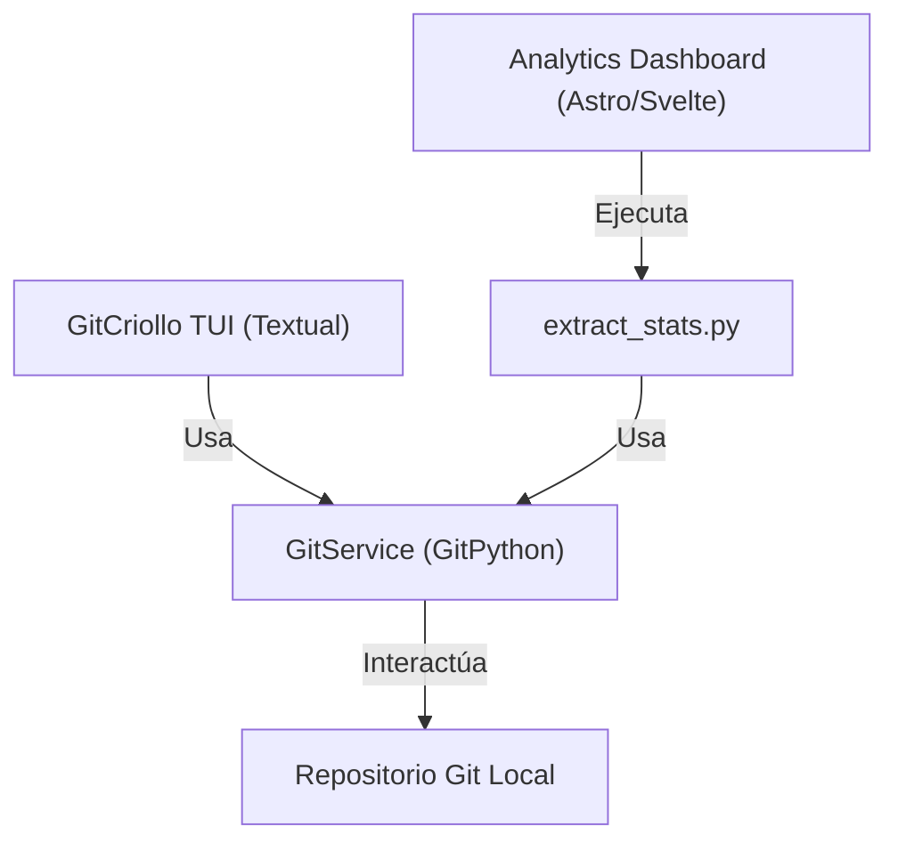

# Evaluación de Estado y Hoja de Ruta de GitCriollo

## 1. Opinión Técnica del Proyecto (Post-Correcciones)

Tras aplicar las correcciones sobre la lógica de Git, la seguridad de la UI y los tests, **GitCriollo ha pasado de ser un prototipo funcional a una herramienta confiable, predecible y lista para uso real diario**.



### Tabla Comparativa de Madurez

| Aspecto | Antes de las correcciones | Estado Actual |
|---|---|---|
| **Estabilidad de UI** | Crasheos potenciales por `MarkupError` (corchetes en código de conflictos o nombres de ramas) | Cadenas dinámicas escapadas con `escape()`. Cero caídas por formato. |
| **Flujos de usuario** | Confirmaciones prematuras de ramas/tags; bloqueo en Stash Push vacío; commit sin staged | Creación atómica en callbacks con `try/except`; stash sin mensaje funcional; validación previa de commit. |
| **Ramas anidadas** | `origin/feature/login` se recortaba erróneamente a `login` (colisiones) | Se preserva la jerarquía completa (`feature/login`). |
| **Cobertura de Tests** | 79 tests (conflictos sin pruebas de resolución; checkout con aserción errónea) | **83 tests pasando al 100%**, cubriendo resolución `ours`/`theirs`/`both`, checkout anidado y agregación de analytics. |
| **Entorno de desarrollo** | `.venv` roto con rutas absolutas inválidas | `.venv` funcional con Python 3.12 y pytest ejecutable directamente en ~0.6s. |

### Fortalezas Destacadas
1. **Diferenciador único: Ecosistema Dual (TUI + Dashboard Web)**: Ninguna de las herramientas populares (LazyGit, Tig, GitUI) ofrece un dashboard web local de analítica integrado con Astro + Svelte + Tailwind. Esto le da un valor agregado tremendo para desarrolladores o líderes de equipo que quieran KPIs rápidos de commits, líneas de código y rachas.
2. **Identidad y usabilidad en español**: La interfaz no se siente como una traducción automática; los términos son naturales, directos y con atajos mnemotécnicos en el teclado.
3. **Stage por Hunks (`H`) y Resolución de Conflictos (`M`)**: Implementar estas dos funciones dentro de una TUI suele ser el punto más difícil; aquí se resolvieron con una arquitectura limpia mediante `DiffHunk` y `ConflictRegion`.

---

## 2. Hoja de Ruta Propuesta (Siguientes Pasos de Evolución)

Para llevar el proyecto a un estándar de calidad equivalente a herramientas consolidadas de código abierto, se proponen las siguientes mejoras agrupadas en cuatro frentes:


---

## User Review Required

> [!IMPORTANT]
> **Adición de búsqueda interactiva con `/`**:
> En repositorios con decenas de ramas o historial extenso, desplazarse con flechas resulta lento. Proponemos añadir un modal o input flotante activado con `/` para filtrar en tiempo real la lista activa (ramas o commits).

> [!TIP]
> **Soporte para abortar Merge y Rebase**:
> Si un merge entra en conflicto o un rebase interactivo se complica, el usuario actualmente debe abrir una terminal externa o usar `r` (comando personalizado) para escribir `git merge --abort`. Se propone agregar un atajo directo (`A` o contextual) para abortar operaciones en curso.

---

## Open Questions

- **Navegación en Historial de Commits**: ¿Prefieres que `l` (`+Commits`) **añada** 20 commits a la lista existente (scroll infinito acumulativo) en vez de reemplazar la pantalla actual?
- **Rotación de Logs**: Actualmente `~/.gitcriollo/debug.log` crece indefinidamente. ¿Deseas limitar el tamaño a un máximo de 5 MB con 3 backups rotativos usando `RotatingFileHandler`?

---

## Proposed Changes (Para la Próxima Fase)

### Componente 1: Navegación y Paginación

#### [MODIFY] `git_criollo/ui_actions_history.py`
- Modificar `action_mas_commits` para que no limpie la lista, sino que agregue los nuevos commits al final del `ListView`, permitiendo desplazarse libremente hacia arriba y hacia abajo en todo el historial cargado.

#### [MODIFY] `git_criollo/helpers.py`
- Añadir parámetro `append: bool = False` a `render_commit_list` para evitar el `lista.clear()` cuando se está paginando.

---

### Componente 2: Operaciones de Aborto y Estado Git

#### [MODIFY] `git_criollo/git_service.py`
- Añadir métodos:
  - `abort_merge()`: `self.repo.git.merge("--abort")`
  - `abort_rebase()`: `self.repo.git.rebase("--abort")`
  - `is_rebase_in_progress()`: chequea existencia de directorios `.git/rebase-apply` o `.git/rebase-merge`.

#### [MODIFY] `git_criollo/ui.py`
- Si hay un merge o rebase en progreso, mostrar una alerta visible en el header en rojo (`[bold #ff5f5f]MERGE EN PROGRESO - Presioná [M] para resolver o [A] para abortar[/]`).

---

### Componente 3: Suite de Pruebas de UI (Textual Pilot)

#### [NEW] `tests/test_ui_screens.py`
- Pruebas asíncronas con Textual Pilot (`async with app.run_test() as pilot:`):
  - Verificar que presionar `?` abre `VentanaAyuda` y `Escape` la cierra.
  - Verificar que presionar `n` abre `VentanaNuevaRama` y crear una rama actualiza `#lista_ramas`.
  - Verificar que presionar `w` sin staged muestra notificación de aviso sin abrir el modal.

---

### Componente 4: Mantenimiento y Logs

#### [MODIFY] `git_criollo/__main__.py`
- Reemplazar `logging.basicConfig` con `RotatingFileHandler(maxBytes=5*1024*1024, backupCount=3)` para proteger el disco del usuario.

---

## Verification Plan

### Automated Tests
1. Ejecutar tests unitarios existentes:
   ```bash
   .venv/bin/pytest tests/
   ```
2. Ejecutar los nuevos tests de integración de Textual Pilot en modo headless:
   ```bash
   .venv/bin/pytest tests/test_ui_screens.py
   ```

### Manual Verification
1. Abrir `gitcriollo` en un repositorio con más de 40 commits y presionar `l`: verificar que los commits se acumulen y se pueda navegar con flechas a los primeros commits.
2. Iniciar un merge en conflicto forzado y verificar que el header indique el estado y permita abortarlo directamente con confirmación.
